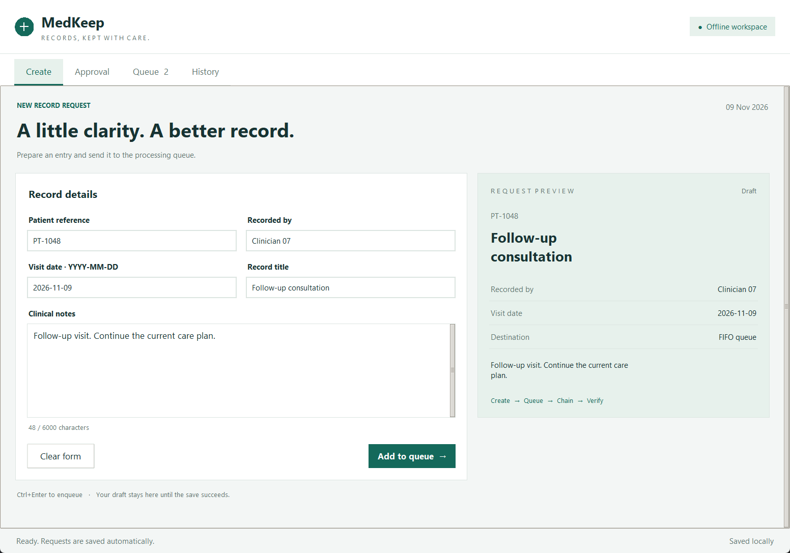

# MedKeep

**An offline Python desktop application for creating, queuing, verifying, and archiving medical-record entries.**

MedKeep implements the course project's singly linked content/seal chain, FIFO request queue, and SHA-256 hash function **by hand**. The selected dark Clinical interface separates each workflow into its own tab. No third-party packages or internet connection are required.



## Start the application

Use **Python 3.11 or newer with Tcl/Tk**. From the project directory:

```console
python -m medkeep
```

You can also run `python run.py`. On Windows, double-click `run.pyw` to launch without a console. Windows Python installers usually include Tcl/Tk; on Debian/Ubuntu, install `python3-tk` if it is missing. `python -m tkinter` checks that the toolkit can open a window. There are no packages to install from `requirements.txt`.

Use another local workspace when needed:

```console
python -m medkeep --data-dir "D:\MyMedKeepWorkspace"
```

The default workspace is `data/` beside the source package. Pending requests and processed records are saved automatically in `data/medkeep.mkd`; archives go into `data/archives/`. A workspace can be opened by one MedKeep window at a time. The application starts empty and does not insert sample patients into your workspace.

## The four tabs

| Tab | What it does |
| --- | --- |
| **Create** | Validates the patient reference, clinician, visit date, title, and notes; shows a live preview; saves a new request at the back of the queue. |
| **Approval** | Recalculates the chain hashes, shows each comparison, and exposes stored/calculated hashes for a selected node. Approval means integrity verification. |
| **Queue** | Shows pending requests in arrival order and processes the oldest into a content node and a seal node. Selecting another row does not change FIFO order. |
| **History** | Opens after verification, shows records newest first, searches by patient/title/request, and exports verified records for a chosen processing date. |

Adding a request to the queue keeps the current approval and History available. Processing a request changes the chain and requires a fresh approval. History verifies again before reading. Failed saves keep the original queue and snapshot. MedKeep preserves damaged workspace files for recovery. Daily archives leave the original chain intact.

Keyboard shortcuts: **Ctrl+Enter** saves a Create request, **Ctrl+1–4** changes tabs, **Ctrl+Tab** cycles tabs, and **F5** verifies integrity. Pages scroll when the window is small. Expensive operations run outside the GUI thread, and closing during a save waits for that operation to finish.

Read the [user guide](docs/user-guide.md) for a complete first-run walkthrough and recovery advice. See [the design references](docs/interface-concepts.md) for the original Clinical selection.

The application uses the approved preview's dark green surfaces, soft mint accents, rounded cards and controls, and outline tab icons. The fixed palette and design reference are documented in [the Clinical theme notes](docs/clinical-theme.md).

## Hand-written algorithms

- **FIFO queue:** custom nodes, front/rear references, enqueue, peek, and dequeue.
- **Singly linked chain:** one backward reference per node; alternating content/seal nodes; explicit genesis sentinel and append logic.
- **Result sequence:** custom linked storage for verification steps, extracted records, and serialization chunks.
- **SHA-256:** custom padding, rotations, word expansion, 64 compression rounds, state updates, and digest assembly. Its message schedule is a custom 16-node circular linked buffer.
- **Verification:** newest-to-oldest traversal checks node positions, kinds, references, hashes, record encoding, and FIFO order before releasing record contents.

No `hashlib`, `queue`, `collections.deque`, third-party linked lists, list-as-queue, or dict-as-chain shortcuts are used. The core does not store its items in built-in lists, dictionaries, sets, or arrays. Immutable bytes/strings, scalar tuple assignments, type metadata, GUI widget options, and standard-library internals are not substitute domain containers.

The hash implementation follows [NIST FIPS 180-4](https://nvlpubs.nist.gov/nistpubs/FIPS/NIST.FIPS.180-4.pdf). It is a hand-written implementation of a studied algorithm, not a library wrapper. See [the algorithm walkthrough](docs/algorithms.md) for formulas, complexity, the two-node representation, and the unprotected-tail rule.

## Source layout

```text
medkeep/
  hashing.py          Handmade SHA-256 and circular word schedule
  structures.py       Hand-written FIFO queue and linked result sequence
  records.py          Immutable records, validation and binary field encoding
  chain.py            Content/seal chain and integrity verification
  storage.py          Versioned snapshots, file locking and atomic saves
  service.py          Transactional record processing and daily archives
  ui.py               Clinical desktop interface
  appearance.py       Dark Clinical colors, rounded surfaces and UI assets
  platform_support.py Windows display-scaling support
  __main__.py         Command-line launcher
tests/                Algorithm, storage, constraints and native UI checks
docs/                 Requirements, explanations and synthetic screenshots
tools/                Clean source/submission ZIP helper
```

The model and service do not depend on Tkinter. See [the storage design](docs/storage.md) for the file format, resource limits, write-failure behavior, and security decisions.

## Run the checks

```console
python -m unittest discover -v
```

The **52 tests** cover published SHA-256 vectors (including one million `a` bytes), incremental hashing and padding boundaries, FIFO operations, paired-node construction, tampering and cycles, Unicode, restart recovery, failed writes, external edits, archive dates, source packaging, and all four native UI workflows. A source constraint check protects against ready-made collection/hash shortcuts. The eight native UI tests require a display and skip when none is available; on a Linux CI runner they can run under Xvfb. A separate-process visible-window check detects native redraw hangs with a bounded timeout.

All four actual desktop tabs and the smaller-window layout were visually inspected on Windows. Screenshots use temporary synthetic records.

Local validation passes on Windows/Python 3.14, including the visible-window check. The 43 non-GUI checks were also validated on Python 3.12. GitHub Actions runs the suite on Windows with Python 3.11 and 3.14. Its third-party actions are pinned to exact official commit hashes, with read-only repository permissions.

## Scope and security

This is a single-user educational project. It has no network service, login system, encrypted storage, or clinical certification. Use synthetic data when demonstrating it. Hashes detect inconsistencies relative to the stored chain; a privileged attacker can rewrite and recompute an entire chain, and suffix removal needs a separately trusted head digest to be detected. Protect the workspace and exported archives through your operating system.
