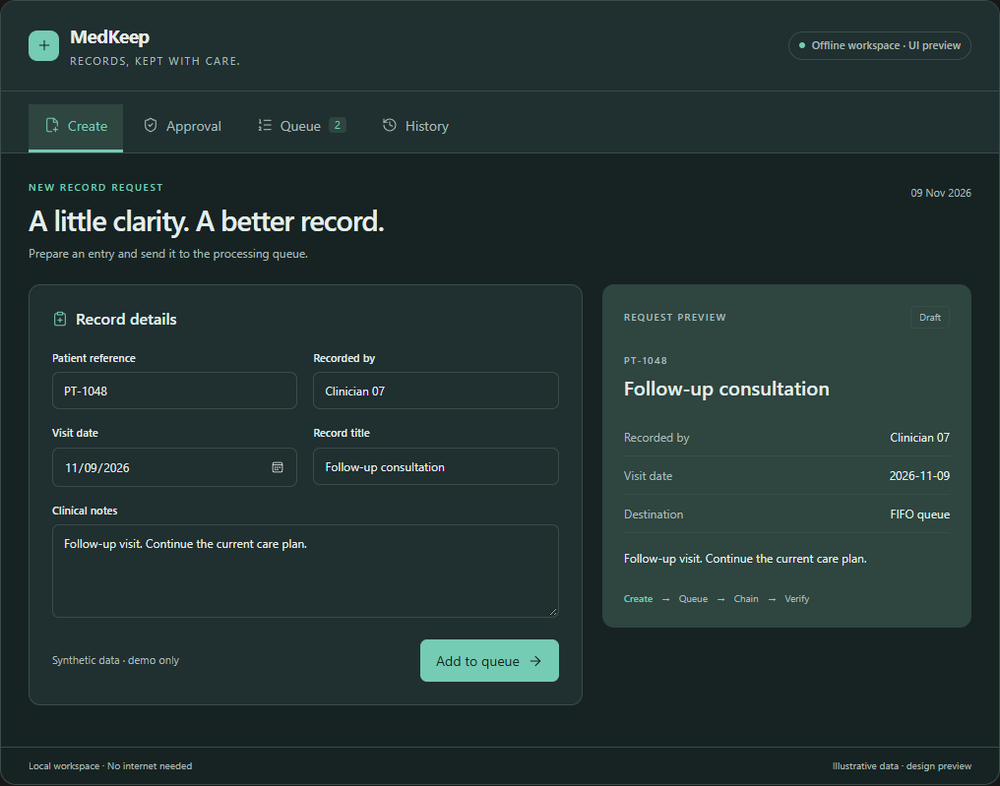
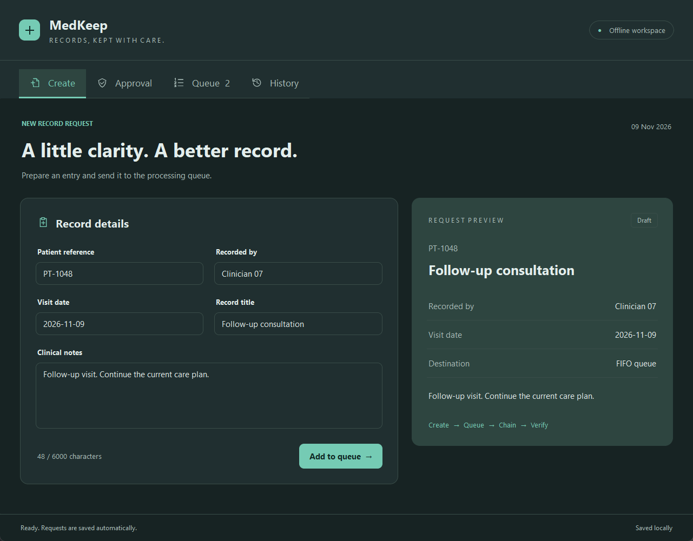

# Approved dark Clinical appearance

The dark version of the Clinical preview is the visual reference for the Python application. The palette is fixed, so the application opens with this appearance independently of the chat's current theme.

## Exact preview palette

| Role | Color |
| --- | --- |
| Main background | `#172323` |
| Header, form and record surfaces | `#202f30` |
| Main text | `#e3eeec` |
| Secondary text | `#a9bcb8` |
| Borders and dividers | `#3a4d49` |
| Mint accent | `#75cbb4` |
| Text on mint buttons | `#102a25` |
| Preview/selection fill | `#2e4540` |
| Error text | `#ffa6b1` |

`medkeep/appearance.py` owns these values. Cards use 12-pixel logical corner radii; inputs and buttons use 7-pixel radii. The header's rounded square medical mark, outline navigation icons, selected-tab underline, draft badge, form-to-preview proportions, typography, and spacing follow the reference. History places its selected record alongside the list. Scrollbars stay hidden until needed.

The rounded controls and icons are generated from small raw PNG buffers using Python's standard library and Tk. PNG's file-format CRC is separate from medical-record hashing, which still uses only the project's handmade SHA-256. No third-party theme, image package, queue, or linked-list library is introduced.

Native inputs retain keyboard focus and selection feedback, and the note field supports long text and undo. Existing request processing, verification, persistence and archives use the same application service. Windows system chrome is asked to use a dark caption, and logical dimensions follow display scaling.

The actual four tabs and smaller-window layout were visually checked with temporary synthetic records. The native workflow suite includes a bounded visible-window probe so a Windows/Tk redraw loop cannot hide behind checks of a withdrawn window.

