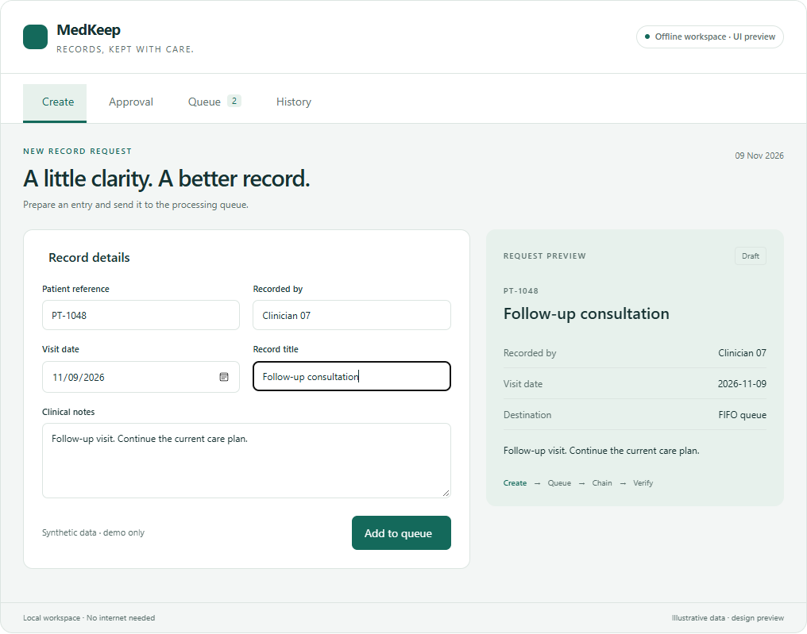
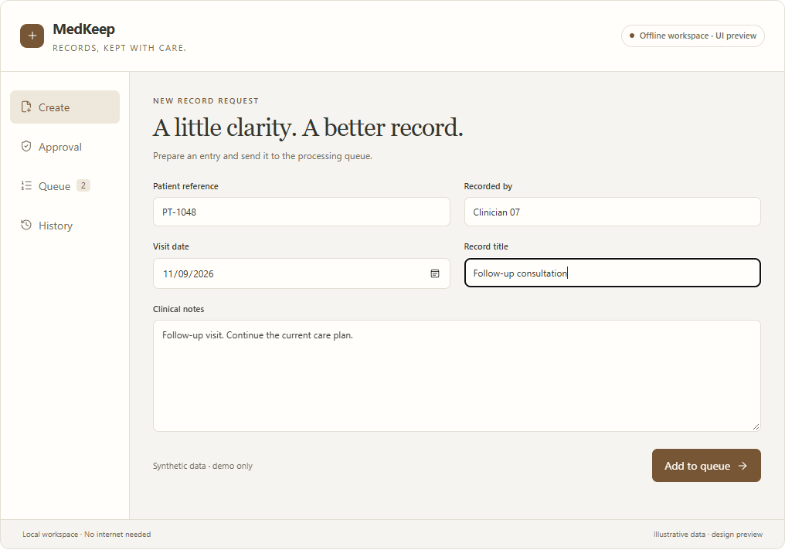
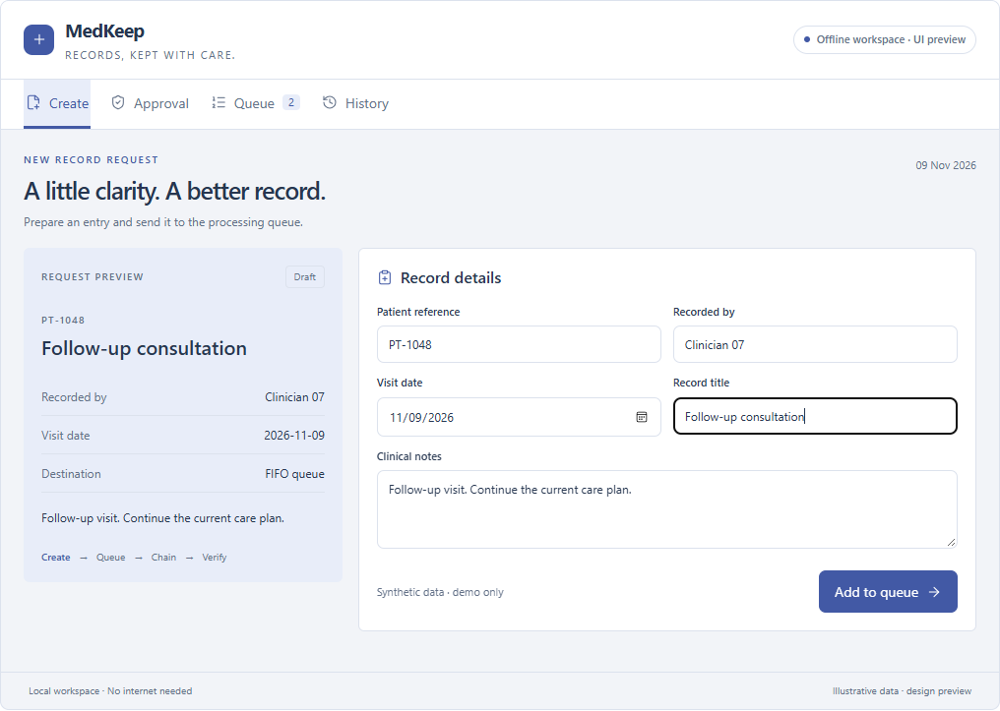

# Interface concepts

**Selected: Clinical.** The project owner approved this concept before Python application implementation. All screens below are the original design previews with synthetic content. Their demonstration interactions do not implement the project's chain, queue, hashing, persistence, or archive algorithms.

All concepts separate **Create**, **Approval**, **Queue**, and **History**. Approval means integrity verification. History is gated behind that verification in the preview. The proposed fields are conveniences rather than fields required by the PDF.

## Clinical

A calm teal workspace with horizontal tabs. The form sits alongside a live request preview, making it easy to check details before enqueueing a record. Recommended for a balance of clarity and efficient use.

## Workspace

A warm, focused writing surface with vertical tabs. A wider central editor reduces distractions and gives notes more room.

## Ledger

A compact blue workbench with horizontal tabs. A request summary sits to the left of a denser form, making the layout familiar to people who work with administrative records.

## Preview verification

The three concepts were checked in a browser for:

- Navigation among all four sections.
- Live form-to-preview updates.
- Demonstration enqueueing and processing the oldest synthetic request.
- Verification-gated history, selecting a sample record, and opening an archive preview.
- Horizontal overflow at 1024, 736, 375, and 320 pixel content widths.
- Absence of script runtime errors.

Desktop screenshots of all three concepts and a Clinical dark/narrow view were also visually inspected. These checks validate the design preview only. The application and its algorithms have not been implemented or tested yet.
