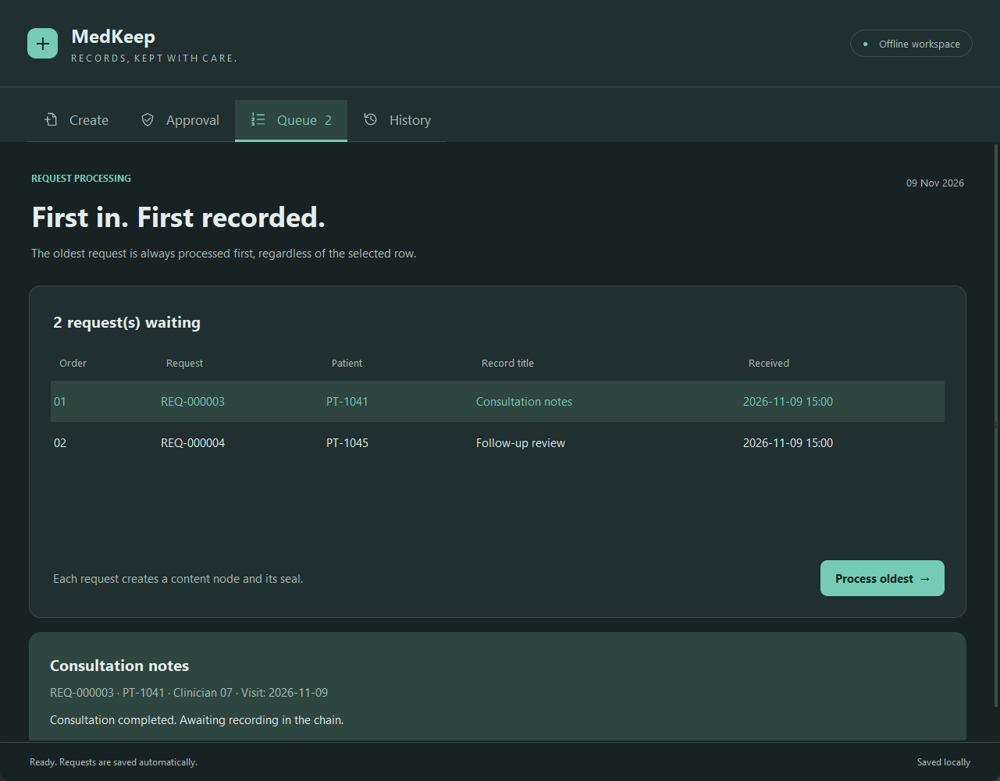
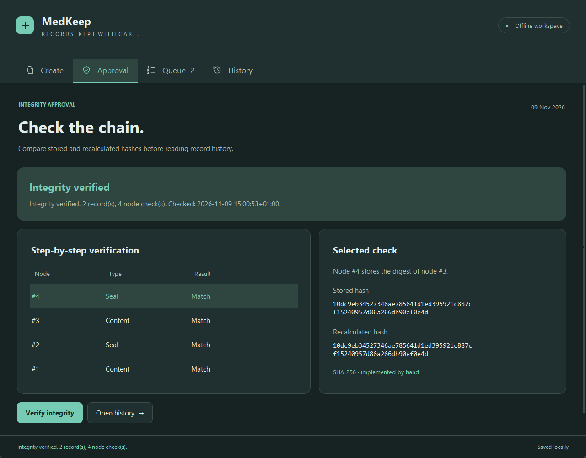
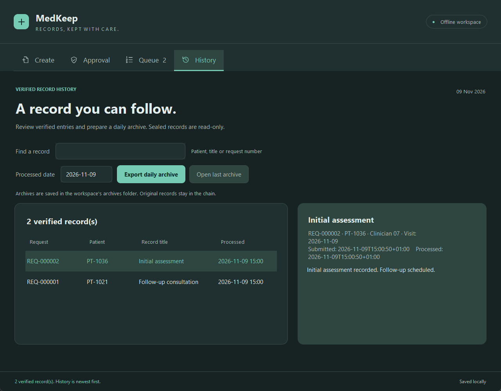

# Using MedKeep

## Launch

Run `python -m medkeep` from the project directory, `python run.py`, or double-click `run.pyw` on Windows. Python 3.11+ and Tcl/Tk are sufficient; the application does not need an internet connection or third-party packages. `--data-dir PATH` selects a separate workspace.

The application opens with an empty workspace. The screenshots in this repository contain synthetic demonstration entries; no sample patients are added to your data automatically.

## Create a request

Open **Create** and enter a patient reference, clinician/author, visit date in `YYYY-MM-DD` form, title, and notes. A preview updates while you type. Patient reference, author, title and notes are required. Limits are 64, 80, 120, and 6,000 characters respectively. Unicode text is preserved; visual right-to-left shaping depends on the installed Tcl/Tk version.

Choose **Add to queue** or press **Ctrl+Enter**. A successful save gives the request a stable number. It clears patient/title/notes for the next entry, preserving the clinician and visit date. A validation or save failure keeps the draft visible so you can correct it. The character count beside the save button shows the notes limit.

## Process the queue

Open **Queue**. Rows are in request arrival order. Select a row to inspect its notes; selection does not change the processing order. Choose **Process oldest** to create the oldest request's content node and seal node.

Requests and processed records are saved locally after each successful operation. Restarting preserves pending requests in the same order. Processing checks the existing chain first; a broken chain blocks new writes. A full queue or workspace explains its limit without dropping data.

## Verify integrity

Open **Approval** and choose **Verify integrity**, or press **F5**. The report checks the entire chain newest to oldest. Select a row to compare its stored and recalculated hashes. Genesis uses a zero-hash sentinel. The newest seal's own content is ignored according to the assignment's rule; it is never presented as a medical record.

On success, History becomes available. On failure, the report identifies the issue and blocks record extraction and writes. Verification is an integrity check, not clinician authorization or a guarantee that the underlying medical statement is true. A later saved request or processed record requires a fresh explicit approval.

## Review and archive

Open **History** after a successful check. It verifies again before opening the records. The list is newest first. Search by patient reference, title or request number, and select a row to read its details. Notes are read-only; use the note area's mouse wheel to read a long entry. Corrections should be new requests, because sealed records cannot be edited through the interface.

For a daily archive, enter its **processing date** and select **Export daily archive**. This date is when the request entered the chain, which can differ from its visit and submission dates. The application verifies immediately before exporting and saves a readable UTF-8 file under the workspace's `archives` directory. **Open last archive** opens it in the operating system's associated text viewer.

Exporting does not clear or alter the chain. Repeating an export creates another file. A date with no records produces a clear message and no empty archive.

## Shortcuts and smaller displays

| Shortcut | Action |
| --- | --- |
| Ctrl+Enter | Save a Create request |
| Ctrl+1 / 2 / 3 / 4 | Create / Approval / Queue / History |
| Ctrl+Tab | Cycle tabs |
| F5 | Verify the current chain |
| Ctrl+A in notes | Select the draft's entire notes field |

Use the page scrollbar or mouse wheel when the window is short. Scrollbars appear when their content needs scrolling. The notes and record tables also have their own scrolling. The dark Clinical theme matches the approved preview, and Windows rendering respects display scaling. During a save or verification, action controls are disabled to prevent duplicate operations. Closing waits for the current operation to finish.

## Workspace problems

- **Already open:** close the other MedKeep window using this directory, or choose a different `--data-dir`. A leftover `.medkeep.lock` filename alone does not mean a process is still running; the operating system enforces the live lock.
- **Outside changes:** restart to inspect the current file. MedKeep will not overwrite a snapshot changed by another program.
- **Checksum, format or integrity failure:** preserve the file and use a known-good full-workspace backup for recovery. The application never resets it automatically or rebuilds hashes to hide the problem.
- **Save failure:** check permissions and free disk space, then retry. The saved queue remains intact and an unsaved Create draft stays visible.
- **Tkinter missing:** install Python with Tcl/Tk support. `python -m tkinter` should open a toolkit test window. Many Linux distributions provide `python3-tk` separately.

Snapshots and text archives are not encrypted. Keep their containing directory private and back up the entire workspace while the application is closed. Archives are readable reports, not an import/restore format. See [the storage design](storage.md) for exact limits and recovery assumptions.
